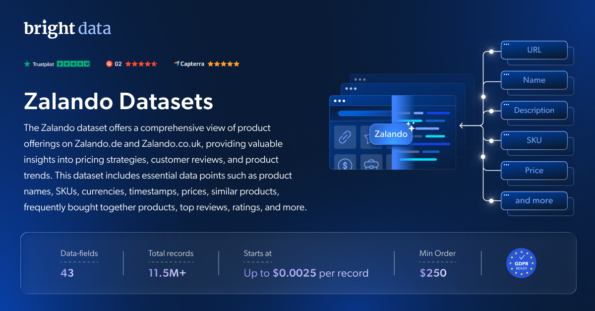

# Zalando-dataset-samples

<h2>包含 1001 款 Zalando 商品的示例数据集</h2>

<a href="https://www.bright.cn/products/datasets/zalando">
   
</a>

包含超过 1000 条记录的 Zalando 数据集样本。该数据集使用 <b>Bright Data API</b> 提取。

<h2>Zalando 数据集中包含的部分数据点：</h2>

* ```domain```：商品所属的领域或类别
* ```country_code```：与商品关联的国家/地区代码
* ```url```：在线查看商品完整详情的 URL 或链接
* ```sku```：库存单位，即商品的唯一标识符
* ```condition```：商品的状况
* ```gender```：商品的目标性别
* ```product_name```：商品的名称或标题
* ```brand```：商品的品牌
* ```description```：商品的详细描述
* ```manufacturer```：商品的制造商或生产商
* ```badges```：与商品关联的任何特殊徽章或标签
* ```initial_price```：商品的初始（原始）价格
* ```final_price```：商品的最终（折后）价格
* ```discount```：商品适用的折扣百分比
* ```currency```：标价所使用的货币
* ```inventory```：商品的可用库存信息
* ```is_sale```：表示商品目前是否正在促销

以及更多内容。

这是“Zalando 商品”数据集的示例子集，完整数据集包含超过 <b>970 万条记录</b>。

可用的数据集文件格式：<b>JSON、NDJSON、JSON Lines、CSV 或 Parquet。还可选择将文件压缩为 .gz 格式</b>。

数据集交付方式选项：<b>电子邮件、API 下载、Webhook、Zalando S3、Google Cloud Storage、Google Cloud PubSub、Microsoft Azure、Snowflake、SFTP</b>。

更新频率：<b>单次、每日、每周、每月、每季度或自定义频率</b>。

可在提取的数据点基础上添加数据扩充：<b>根据需求。</b>

<b>[获取完整的 Zalando 数据集](https://www.bright.cn/products/datasets/zalando)</b>。

<a href="https://www.bright.cn/products/datasets/zalando">
   
</a>

<h2>Zalando 数据集有哪些使用场景？</h2>

<h3>1. 定价优化</h3>
通过将 Zalando 的商品和类别与竞争对手进行比较，制定定价策略并实施动态定价模型。

<h3>2. 商品库存优化</h3>
识别库存缺口，跟踪特定商品增长的需求，并突出 Zalando 商品系列中的热门商品。

<h3>3. 市场策略优化</h3>
使用 Zalando 数据集分析关键趋势和客户偏好，从而优化市场策略。

<h2>为学术研究人员和 NGO 免费提供网页爬虫工具和数据集</h2>

Bright Initiative 为领先的高校院系和研究人员，以及致力于推动各类环境与社会事业的 NGO 和非营利组织提供 Bright Data 的 <b>[网页爬虫工具 API](https://www.bright.cn/products/web-scraper)</b> 和 <b>[即用型数据集](https://www.bright.cn/products/datasets)</b>。你可以在<b>[此处](https://brightinitiative.com)</b>提交申请。
